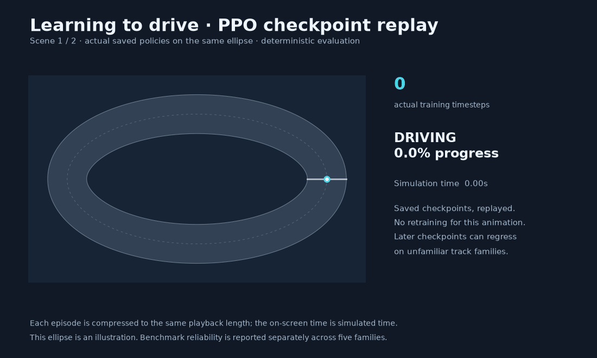
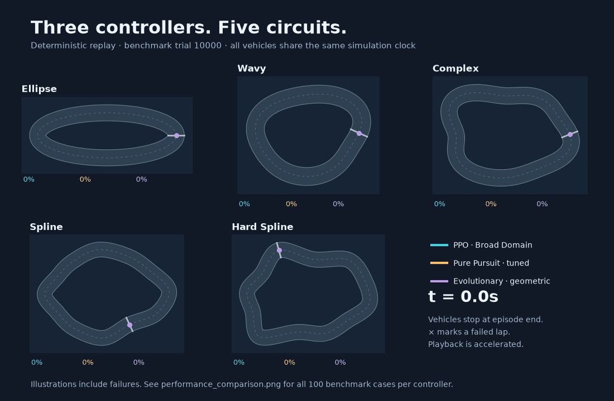
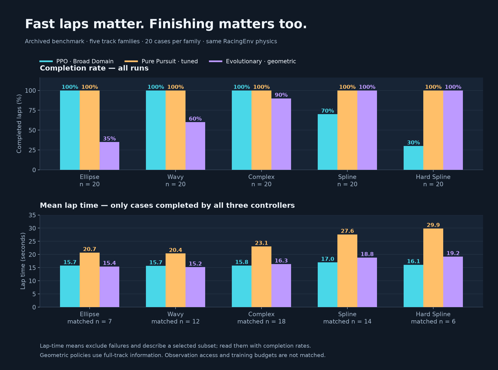
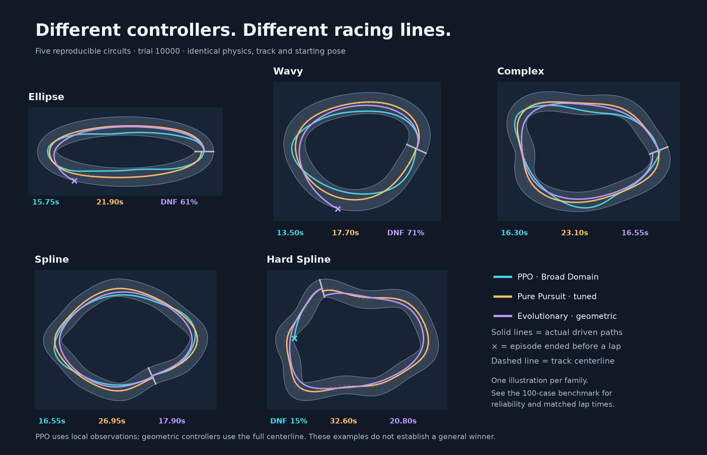

# RL Racing Line Optimization

A Python racing research project exploring how reinforcement learning and evolutionary search trade lap time against reliability. It includes a custom 2D simulator, Stable-Baselines3 PPO policies, a geometric Pure Pursuit baseline, an evolved controller, procedural circuits, and reproducible evaluation scripts.

**The main result:** the tuned Pure Pursuit baseline completed all 100 test circuits. Broad Domain PPO completed 80 and drove faster on its successful laps; the evolved geometric controller completed 77, with stronger results on spline circuits and weaker results on ellipses. These experiments expose a speed–reliability tradeoff rather than a universal winner.

[Experimental results](docs/RESULTS.md) · [Checkpoint information](docs/CHECKPOINTS.md) · [Visual provenance](assets/README.md)

## Watch the project



The animation separates two experiments: real PPO checkpoint rollouts and the recorded fitness history of the shared-physics evolutionary controller. PPO training steps and evolutionary generations are different measures. The historical PPO filenames use nominal milestone labels; their actual saved step counts are documented in [the results](docs/RESULTS.md#ppo-learning-demonstration).



Broad Domain PPO, tuned Pure Pursuit, and the evolved geometric controller drive the same deterministic example from each track family. Failed runs remain visible. These examples illustrate behavior; the benchmark below covers 20 circuits per family.

## What is included

| Component | Purpose |
| --- | --- |
| `src/racing_env.py` | Gymnasium environment with continuous steering and throttle/brake actions |
| `src/simulator.py`, `src/vehicle.py` | Fixed-step vehicle simulation, grip-limited steering, checkpoints, and lap validation |
| `src/track_geometry.py`, `src/track_factory.py` | Track geometry and ellipse, wavy, complex, spline, and hard-spline circuits |
| `train_ppo.py`, `train_visual_demo.py` | PPO training and saved learning milestones |
| `benchmark_ppo.py`, `benchmark_heldout.py` | PPO learning and procedural-track evaluation |
| `benchmark_centerline.py`, `benchmark_centerline_tuned.py` | Original and tuned Pure Pursuit comparisons |
| `evolve_shared_physics.py` | Evolution of a nine-parameter geometric controller in the PPO simulator |
| `compare_matched_laps.py`, `analyze_racing_lines.py` | Successful-lap matching, trajectory analysis, and telemetry plots |
| `ppo_learning_replay.py` | Interactive replay of saved PPO checkpoints |
| `racing_showcase.py`, `racing_results.py` | Interactive population evolution and saved-map results in a separate demonstration simulator |
| `generate_assets.py` | Regeneration of the published figures and animations |

## Installation

Run commands from the repository root. A CPU is sufficient for inference and evaluation; retraining requires more time. The project has been checked with Python 3.14.4. Dependency versions and checkpoint details are recorded in [CHECKPOINTS.md](docs/CHECKPOINTS.md).

```bash
git clone https://github.com/preetagam205-tech/rl-racing-line-optimization.git
cd rl-racing-line-optimization
python3 -m venv .venv
source .venv/bin/activate
python -m pip install --upgrade pip
python -m pip install -r requirements.txt
python scripts/verify_project.py
```

On Windows, activate the environment with `.venv\Scripts\activate`. Interactive viewers require a desktop display and Pygame; benchmark CSVs and generated figures can be produced without opening a window.

The verification command checks the environment, checkpoint inference, and saved benchmark consistency without training or replacing benchmark files. Model checkpoints are included in the repository, so evaluating the published policies does not require retraining or a separate download.

## Try it

Replay the real PPO learning snapshots:

```bash
python ppo_learning_replay.py
```

Use **N/P** or **1–5** to change maps, **Space** to pause, **F** for faster playback, **Tab** to switch between all policies and one policy, **Up/Down** to select a policy, and **R** to restart. Playback does not update model weights.

Watch evolutionary learning across maps:

```bash
python racing_showcase.py --cars 120 --seed 12
python racing_results.py --checkpoints racing_checkpoints
```

The showcase restores saved populations and saves progress after each generation. **N/P** changes the selected map, **Space** pauses, **F** changes speed, **Tab** switches to champion replay, and **S** saves. Only the selected map trains. This showcase uses its own vehicle dynamics; its generations and lap times are separate from the scientific comparison in `RacingEnv`.

## Methodology

The shared evaluation uses a kinematic bicycle model with a 0.05-second timestep, a maximum speed of 20 simulation distance units per second, a 2.5-unit wheelbase, and a lateral-acceleration steering limit of 8 units/s². A lap requires passing seven ordered checkpoints and crossing the start gate in the forward direction. Leaving the track ends the episode; unfinished runs time out after 60 simulated seconds.

**PPO** learns continuous steering and acceleration/braking from local state. The standard observation has ten values: speed, lateral and heading error, six heading lookahead values, and available steering authority. An optional 16-value observation adds six curvature estimates. Reward combines forward progress, checkpoint and lap bonuses, a lap-time incentive, and penalties for time, very low speed, track edges, and leaving the road.

**Pure Pursuit** follows the centerline with a speed-dependent lookahead and curvature-aware speed control. The reported tuned baseline can use the vehicle's full 20-unit/s speed range; the original baseline script retains its earlier 17-unit/s cap.

**Evolutionary control** optimizes nine geometric controller parameters through elite selection and Gaussian mutation, including lookahead, steering gain, speed targets, curvature horizon, and line offset. This controller is not an evolved neural network. Its saved training run covers two circuits per family, distinct from the evaluation trial IDs.

All benchmarked controllers share tracks, starts, vehicle dynamics, and lap rules. Their information and training budgets differ: geometric controllers receive the full centerline, while PPO receives local observations. See [the full protocol and limitations](docs/RESULTS.md).

## Results

The saved test suite contains **20 circuits per family**, five families, and 100 runs per controller. The two PPO rows are different saved policies.

| Controller | Ellipse | Wavy | Complex | Spline | Hard spline | Overall completed |
| --- | ---: | ---: | ---: | ---: | ---: | ---: |
| Tuned Pure Pursuit | 100% | 100% | 100% | 100% | 100% | 100/100 |
| Broad Domain PPO | 100% | 100% | 100% | 70% | 30% | 80/100 |
| Hard Five Family PPO | 100% | 85% | 50% | 55% | 40% | 66/100 |
| Evolved geometric | 35% | 60% | 90% | 100% | 100% | 77/100 |

Broad Domain PPO reduced mean per-circuit lap time relative to tuned Pure Pursuit by **25.90% on ellipses, 21.79% on wavy circuits, and 31.40% on complex circuits**, with both methods completing all 20 runs in each of those families. Larger conditional improvements on spline circuits come with substantial PPO failure rates and should not be interpreted as overall superiority.



The lap-time panel uses only circuits where all three displayed controllers finished, and labels the number of matched circuits. Completion rates use all 20 circuits in each family.



The analysis includes path length, speed, steering changes, and distance from the centerline. A smaller centerline error is a tracking metric, not proof of a faster or optimal racing line. Full tables, sources, and interpretation are in [docs/RESULTS.md](docs/RESULTS.md).

## Reproduce the evaluation

These commands evaluate the bundled checkpoints and regenerate the corresponding result files. They overwrite outputs in their documented result directories; use a fresh clone when preserving the published snapshot matters.

```bash
# PPO versus tuned Pure Pursuit: 20 circuits per family, IDs 10000–10019
python benchmark_centerline_tuned.py --trials 20 --trial-start 10000

# Evolved controller versus the same two PPO policies on the same circuits
python evolve_shared_physics.py evaluate --trials 20 --trial-start 10000

# Pairwise timing comparisons only where both policies completed the circuit
python compare_matched_laps.py

# PPO trajectory and telemetry analysis
python analyze_racing_lines.py --trials 20 --trial-start 10000

# Six PPO learning snapshots, five circuits per family
python benchmark_ppo.py --trials 5

# Rebuild the presentation assets from saved benchmark and rollout data
python generate_assets.py
```

For a quick evaluation, use `--trials 1` with the benchmark commands. This produces a smoke-test result, not the published 20-circuit summary. `python generate_assets.py --refresh-rollouts` reruns the example trajectories used in the visual assets.

## Train your own controllers

Train a new policy with an explicit preset, budget, seed, and output path:

```bash
python train_ppo.py --preset broad-domain --timesteps 4500000 --seed 42 --output experiments/ppo_broad_domain --device cpu

# A short seeded run that saves PPO learning snapshots
python train_visual_demo.py --timesteps 500000 --seed 42 --output-dir experiments/visual_training --device cpu
```

`train_ppo.py` also supports `--preset hard-five-family` and `--preset curvature`; use `--help` for the full options. The trainers record run metadata and use separate experiment paths by default. Shorter `--timesteps` budgets are useful for checking the training workflow, but do not reproduce the published benchmark policies.

The shared-physics evolutionary trainer accepts an explicit seed and training budget:

```bash
python evolve_shared_physics.py train --generations 20 --population 20 --train-trials 2 --seed 2026
```

This writes `evolution_shared_physics/best_controller.json` and `training_history.csv`. The published champion records seed 2026 and training trial IDs 200 and 201. Its history contains 20 generations; the original checkpoint does not record population size, so the command specifies the current default rather than claiming a complete historical run manifest.

Fresh training is a new experiment. The bundled checkpoint files reproduce inference; the historical PPO visual run was unseeded, and complete source revisions and training configurations were not archived for every older policy. Do not expect a fresh run to recreate the historical weights byte for byte.

## Repository layout

```text
rl-racing-line-optimization/
├── README.md
├── requirements.txt
├── .gitignore
├── src/                         # Environment, simulator, vehicle, track generation
├── train_ppo.py
├── train_visual_demo.py
├── benchmark_ppo.py
├── benchmark_centerline.py
├── benchmark_centerline_tuned.py
├── compare_matched_laps.py
├── evolve_shared_physics.py
├── analyze_racing_lines.py
├── racing_showcase.py
├── ppo_learning_replay.py
├── racing_results.py
├── generate_assets.py
├── models/                      # PPO checkpoints and integrity manifest
├── racing_checkpoints/          # Standalone showcase populations
├── baseline_comparison_tuned/   # Pure Pursuit and PPO benchmark data
├── evolution_shared_physics/    # Evolved controller, history, and benchmark data
├── racing_line_analysis/        # PPO trajectories and telemetry
├── docs/
│   ├── RESULTS.md
│   └── CHECKPOINTS.md
└── assets/                      # Figures, GIFs, and provenance
```

Additional evaluation and diagnostic scripts preserve the project's experimental development.

## Limitations and next experiments

This is a simplified 2D simulation with exact track geometry, not a validated real-vehicle model. It does not model perception noise, traffic, tire temperature, drivetrain dynamics, or collisions between vehicles. The benchmark samples a small procedural distribution and evaluates one saved checkpoint per PPO variant and one evolved champion; it does not establish statistical significance across independent training seeds.

The next useful experiments are repeated training seeds, larger untouched test sets, matched observation access and compute budgets, and explicit optimization of lap time subject to a minimum completion rate. More aggressive driving only helps when the controller can finish the circuit.
