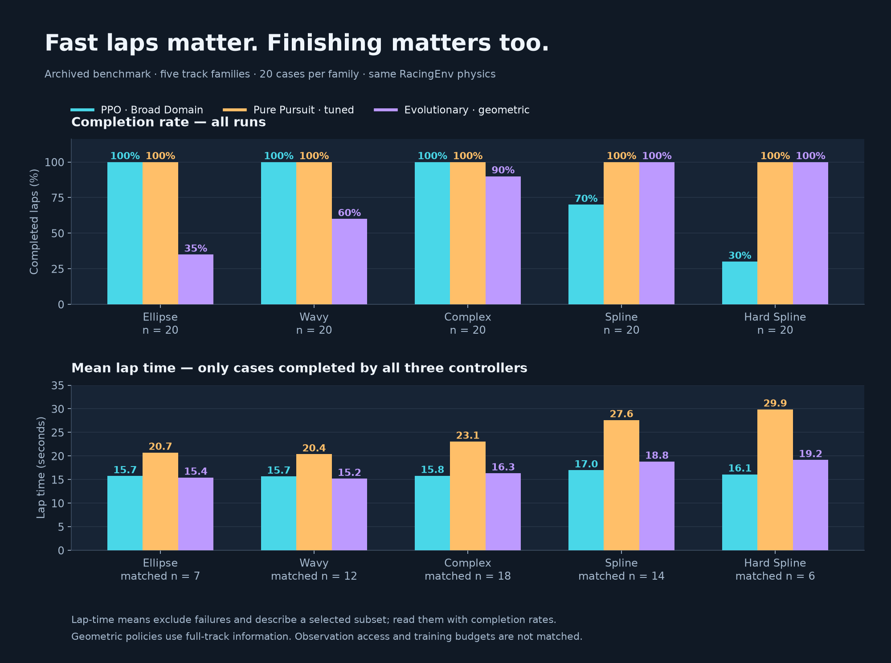
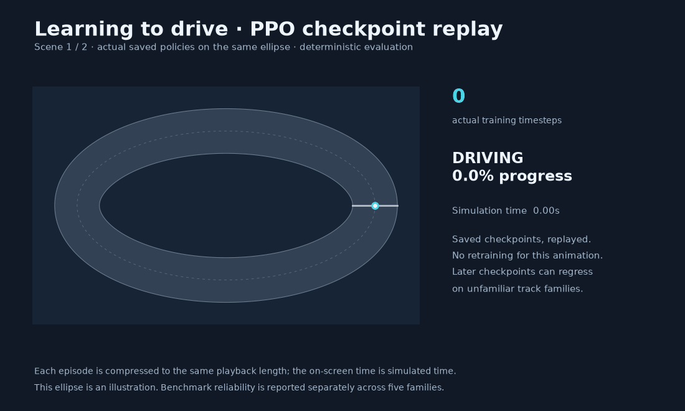
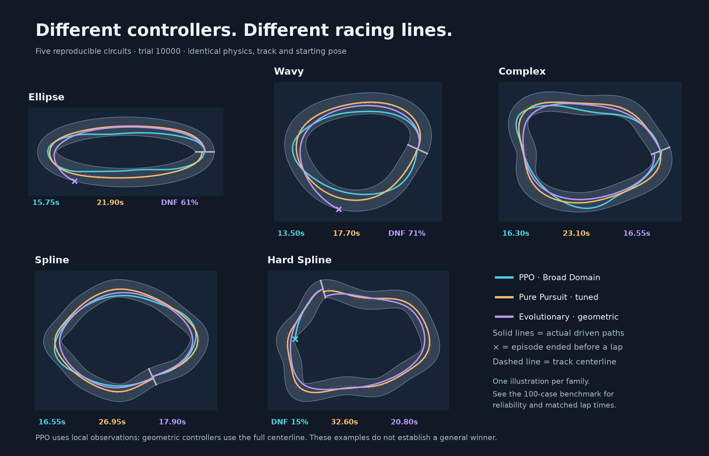

# Experimental Results

This report describes the checked-in experimental data. The central comparison uses the same `RacingEnv` for PPO, tuned Pure Pursuit, and an evolved geometric controller. The interactive population showcase is a separate experiment and contributes no lap times to these tables.

## Data and protocol

| Artifact | Contents |
| --- | --- |
| [`baseline_comparison_tuned/baseline_comparison_runs.csv`](../baseline_comparison_tuned/baseline_comparison_runs.csv) | 300 runs: Pure Pursuit and two PPO variants |
| [`baseline_comparison_tuned/baseline_comparison_summary.csv`](../baseline_comparison_tuned/baseline_comparison_summary.csv) | Per-controller, per-family aggregates |
| [`evolution_shared_physics/comparison_runs.csv`](../evolution_shared_physics/comparison_runs.csv) | 300 runs: evolved controller and the same two PPO variants |
| [`evolution_shared_physics/comparison_summary.csv`](../evolution_shared_physics/comparison_summary.csv) | Shared-physics evolutionary comparison aggregates |
| [`evolution_shared_physics/best_controller.json`](../evolution_shared_physics/best_controller.json) | Saved nine-parameter evolutionary champion |
| [`evolution_shared_physics/training_history.csv`](../evolution_shared_physics/training_history.csv) | Fitness across 20 generations |
| [`racing_line_analysis/trajectory_metrics.csv`](../racing_line_analysis/trajectory_metrics.csv) | PPO trajectory measurements |
| [`ppo_benchmark_runs.csv`](../ppo_benchmark_runs.csv) | Learning-snapshot evaluation on five circuits per family |
| [`assets/README.md`](../assets/README.md) | Visual sources and regeneration instructions |

The two comparison CSVs repeat the same 200 PPO runs. They represent **400 distinct controller–circuit evaluations**, not 600 independent observations.

The main evaluation uses five circuit families: ellipse, wavy, complex, spline, and hard spline. Each family has 20 deterministic cases with trial IDs **10000–10019**. `benchmark_ppo.build_track` derives track generation seeds from base seed 20261115, family offsets, and the trial ID. All controllers start from centerline index zero at rest; environment reset uses seed 12345. PPO inference is deterministic.

Each track uses 720 centerline samples, width 12, and seven checkpoints. The common vehicle model uses a timestep of 0.05 seconds, wheelbase 2.5, maximum speed 20, maximum mechanical steering of 30°, coasting deceleration 1.5, and maximum lateral acceleration 8, in the simulator's distance/time units. Episodes terminate on a valid lap or an off-track event and time out at 60 simulated seconds. A completed lap requires all checkpoints in order and a forward crossing of the start gate.

The word “held-out” refers to the evaluation case IDs. Evolution trains on IDs 200 and 201 per family, and these evaluation IDs differ from earlier small evaluation cases 0–4. Complete historical PPO training configurations and every tuning decision were not archived, so these results should not be described as an independently audited blind test.

## Controllers and training evidence

| Controller | Inputs and method | Saved evidence |
| --- | --- | --- |
| Tuned Pure Pursuit | Full centerline; geometric lookahead steering and curvature-based speed control | Fixed parameters in `benchmark_centerline_tuned.py` |
| Broad Domain PPO | Local 10-value observation; Stable-Baselines3 PPO `MlpPolicy` | Seed 42; 4,501,504 saved timesteps |
| Hard Five Family PPO | Local 10-value observation; Stable-Baselines3 PPO `MlpPolicy` | Seed 42; 7,501,824 saved timesteps |
| Evolved geometric | Full centerline; nine optimized geometric controller parameters | Seed 2026; two training cases per family; 20 logged generations |

PPO checkpoint metadata records `n_steps=2048`, `batch_size=64`, `gamma=0.99`, `gae_lambda=0.95`, and `ent_coef=0.0` for both benchmarked variants. Those fields do not recover every historical environment or reward revision. The current environment also supports a 16-value curvature observation; that option is separate from these two 10-value policies.

The tuned Pure Pursuit baseline uses lookahead `9 + 0.48 × speed`, a 25-unit curvature horizon, and target speed `sqrt(7 / curvature)` clipped to the range 5–20. `benchmark_centerline.py` preserves an earlier baseline with a 17-unit/s cap. The tables here consistently use the tuned version.

The evolutionary controller optimizes lookahead base and speed dependence, steering gain, cornering acceleration target, minimum and maximum speed targets, throttle gain, curvature horizon, and line offset. Fitness is `300 + 5 × max(0, 60 − lap_time)` for a completed lap, or `1.7 × progress_percent − 20` otherwise. Selection retains elites, the champion, and the initial default controller; mutations are clipped to parameter bounds. The logged best fitness increases from **485.675** in generation 1 to **513.725** by generation 17 and remains there through generation 20.

Shared physics does not imply equal information or equal optimization effort: both geometric controllers access the full centerline, whereas PPO receives local observations. A generation evaluates multiple controllers over multiple circuits, so it cannot be equated to a PPO environment timestep.

## Completion rates

Each cell gives completed laps out of 20 attempts. Overall values aggregate the five equally sized families.

| Family | Tuned Pure Pursuit | Broad Domain PPO | Hard Five Family PPO | Evolved geometric |
| --- | ---: | ---: | ---: | ---: |
| Ellipse | 20/20 (100%) | 20/20 (100%) | 20/20 (100%) | 7/20 (35%) |
| Wavy | 20/20 (100%) | 20/20 (100%) | 17/20 (85%) | 12/20 (60%) |
| Complex | 20/20 (100%) | 20/20 (100%) | 10/20 (50%) | 18/20 (90%) |
| Spline | 20/20 (100%) | 14/20 (70%) | 11/20 (55%) | 20/20 (100%) |
| Hard spline | 20/20 (100%) | 6/20 (30%) | 8/20 (40%) | 20/20 (100%) |
| **Overall** | **100/100** | **80/100** | **66/100** | **77/100** |

The baseline is the most reliable controller in this sample. Broad Domain PPO completes every ellipse, wavy, and complex case but loses reliability on spline families. Evolution has the reverse tendency: it completes all spline cases but fails on many ellipses and wavy circuits. The Hard Five Family name does not imply uniformly better performance; the saved variant only improves hard-spline completion relative to Broad Domain PPO here.

## Successful-lap times

The following means reproduce the saved summary CSVs, in simulated seconds. **Each controller's mean includes only its own successful runs.** The sample counts differ as shown above, so these values alone are not a fair timing ranking.

| Family | Tuned Pure Pursuit | Broad Domain PPO | Hard Five Family PPO | Evolved geometric |
| --- | ---: | ---: | ---: | ---: |
| Ellipse | 20.762 | 15.363 | 16.905 | 15.429 |
| Wavy | 20.317 | 15.893 | 17.015 | 15.188 |
| Complex | 23.170 | 15.810 | 16.675 | 16.344 |
| Spline | 28.660 | 16.979 | 18.568 | 19.238 |
| Hard spline | 31.465 | 16.100 | 17.475 | 20.170 |

### Three-controller matched comparison

To compare Pure Pursuit, Broad Domain PPO, and evolution on identical circuits, retain only trials that **all three** completed. These are the samples used for the timing panel in the published performance figure. Hard Five Family PPO is not included in this three-way intersection.

| Family | Matched circuits | Pure Pursuit mean (s) | Broad Domain PPO mean (s) | Evolved mean (s) |
| --- | ---: | ---: | ---: | ---: |
| Ellipse | 7 | 20.714 | 15.743 | 15.429 |
| Wavy | 12 | 20.367 | 15.658 | 15.188 |
| Complex | 18 | 23.058 | 15.803 | 16.344 |
| Spline | 14 | 27.614 | 16.979 | 18.818 |
| Hard spline | 6 | 29.883 | 16.100 | 19.167 |

Matching removes the difference in circuits used for the timing calculation, but it still conditions on success. A fast mean over six hard-spline successes does not account for the other 14 failures.



### PPO versus Pure Pursuit, matched pairs

`python compare_matched_laps.py` joins results by family and trial ID, then retains cases both controllers completed. Because Pure Pursuit finishes all trials here, the number of pairs equals the PPO success count. “Time improvement” is the mean of per-circuit `100 × (baseline_time − PPO_time) / baseline_time`; it is not the percentage difference between separately rounded group means. Path difference is `100 × (PPO_distance − baseline_distance) / baseline_distance` per circuit.

| Family | Broad PPO pairs | Broad PPO time improvement | Broad PPO path difference | Hard Five PPO pairs | Hard Five PPO time improvement | Hard Five PPO path difference |
| --- | ---: | ---: | ---: | ---: | ---: | ---: |
| Ellipse | 20 | 25.90% | −1.98% | 20 | 18.44% | +4.51% |
| Wavy | 20 | 21.79% | −1.09% | 17 | 15.73% | +3.15% |
| Complex | 20 | 31.40% | −1.51% | 10 | 24.88% | +2.58% |
| Spline | 14 | 38.28% | −2.08% | 11 | 34.62% | +1.81% |
| Hard spline | 6 | 46.09% | −1.12% | 8 | 43.59% | +2.22% |

The time reductions are much larger than the changes in path length. That is consistent with speed control contributing substantially to the observed advantage; these measurements do not isolate a causal contribution from line choice. They do not establish that PPO found the globally optimal racing line.

## PPO learning demonstration

`train_visual_demo.py` trains on one fixed ellipse. The six saved policies are evaluated on five deterministic cases in each family by `benchmark_ppo.py --trials 5`. This learning experiment is separate from the Broad Domain and Hard Five Family PPO comparison.

| Filename milestone | Actual saved PPO timesteps | Ellipse completion | Wavy completion | Complex completion | Spline completion | Hard-spline completion |
| --- | ---: | ---: | ---: | ---: | ---: | ---: |
| 0 | 0 | 0% | 0% | 0% | 0% | 0% |
| 25,000 | 26,624 | 0% | 0% | 0% | 0% | 0% |
| 50,000 | 53,248 | 0% | 0% | 0% | 0% | 0% |
| 100,000 | 104,448 | 0% | 40% | 40% | 20% | 0% |
| 250,000 | 256,000 | 100% | 20% | 20% | 0% | 0% |
| 500,000 | 507,904 | 100% | 0% | 0% | 0% | 0% |

The milestone discrepancy is due to collecting complete PPO rollouts during chunked training. The legacy `ppo_steps` CSV field and interactive viewer labels use the filename milestone; actual counts above come from each archive's `num_timesteps` metadata. The visual checkpoints record `seed=None`, so the original learning run cannot be retrained exactly from a known random seed.

The final visual policy succeeds on ellipses but fails to complete the sampled circuits in the other four families. Progress is not monotonic across families: improving on the training geometry does not guarantee generalization. The GIF is a replay of saved checkpoints, not new online PPO learning and not evidence of universal improvement.



## Racing-line and map demonstrations

`assets/racing_trajectories.png` and `assets/driving_maps.gif` show one deterministic example per family, trial 10000, using the common simulator. The visualization includes partial trajectories for failures. Full-case metrics and PPO telemetry are available in `racing_line_analysis/`, while `analyze_racing_lines.py` regenerates PPO plots and per-step measurements.



Mean absolute lateral error measures centerline deviation, not lap quality. Steering change measures the absolute difference between consecutive normalized steering commands at the fixed simulation timestep; it is not jerk or physical steering acceleration. Failed-run telemetry can cover a shorter portion of a circuit than successful-run telemetry, which limits aggregate comparisons of those measures.

`racing_showcase.py` and `racing_results.py` use the separate simulator in `population_evolution_multitrack.py`, including a different timestep and wheelbase. Their persistent per-map populations are useful for watching selection and replaying champions. Their lap times must not be combined with the shared-physics benchmark.

## Reproduction commands

Install dependencies and use the bundled checkpoints as described in the [README](../README.md). Run from the repository root:

```bash
python benchmark_centerline_tuned.py --trials 20 --trial-start 10000
python evolve_shared_physics.py evaluate --trials 20 --trial-start 10000
python compare_matched_laps.py
python analyze_racing_lines.py --trials 20 --trial-start 10000
python benchmark_ppo.py --trials 5
python generate_assets.py --refresh-rollouts
```

Evaluation scripts overwrite their result files. The visual generator reuses frozen rollout data unless `--refresh-rollouts` is requested. Archive the original outputs before running a different trial count or replacing checkpoints.

To run a new evolutionary experiment with the saved champion's recorded seed and training case count:

```bash
python evolve_shared_physics.py train --generations 20 --population 20 --train-trials 2 --seed 2026
```

The original evolutionary checkpoint does not record population size. The command above supplies the current default explicitly; it is not a guarantee of exact historical regeneration. New training replaces the saved controller and history, so run it in a separate clone if retaining the published champion.

## Limitations

- **Small sample and single saved runs.** Twenty circuits per family and one checkpoint per variant do not quantify variability across training seeds. No confidence intervals or significance claims are reported.
- **Success-conditioned timing.** Lap-time averages exclude failures. Pairwise and three-way matching improve comparability but do not remove survival bias.
- **Unequal information and budgets.** Geometry-aware controllers receive the full map. PPO observes local state, and optimization budgets differ substantially.
- **Incomplete historical provenance.** The repository preserves weights, metadata, CSVs, and current code, but not every original source revision or training configuration. Replaying policies is better specified than reconstructing their training histories.
- **Simplified dynamics.** The model has exact localization and track geometry, a simple steering/grip constraint, and no learned perception, traffic, or realistic tire and drivetrain dynamics.
- **Restricted generalization.** Procedural families share a generator and design assumptions. Results do not imply transfer to real circuits, different physics, or real vehicles.

Useful follow-up work is to repeat training with several seeds, reserve an untouched final test set, equalize information and compute budgets, and compare lap time at a specified minimum completion rate.
